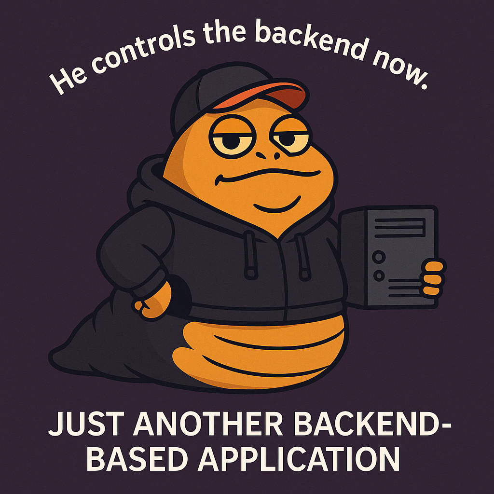

# 🛸 JABBA

**Just Another Backend-Based Application** — compiled graphs of async nodes: independent nodes run in parallel, timeouts and failures are handled by declared policy, and every run produces one schema-versioned record.

Jabba is being built as a polyglot library: one execution semantics, native implementations per language, each built by its own toolchain with no runtime dependencies beyond the language's standard library (the Python service layer aside).

| Directory | What |
|---|---|
| [`python/`](python/README.md) | Python implementation (reference) + FastAPI service layer |
| [`rust/`](rust/README.md) | Rust implementation: `std` only, executor-agnostic |
| [`spec/`](spec/) | Language-neutral semantics, record schema, conformance cases |

A C++ implementation is planned; it will pass the same conformance cases.

License: MIT.
